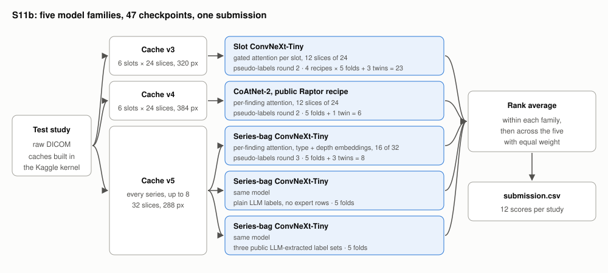
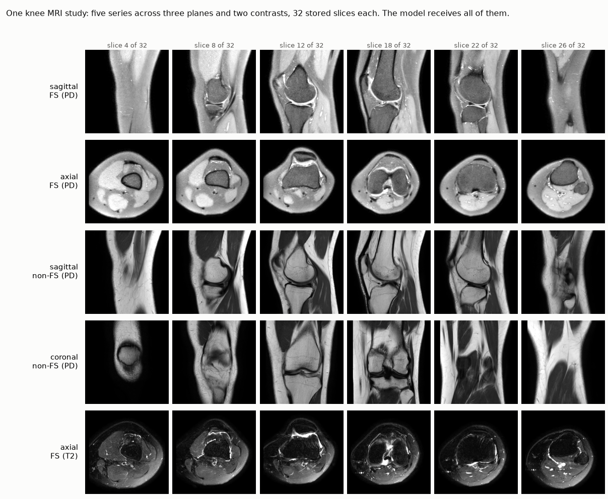

# Knee-Abnormality-Detection

A classifier for the Kaggle RSNA Knee Abnormality Detection competition:
twelve knee findings from MRI, scored by mean ROC AUC.

Best entry scores 0.951 on the public leaderboard. It ensembles five model families,
47 checkpoints in all, trained on labels an LLM extracted from free-text radiology reports.
[SOLUTION.md](SOLUTION.md) explains how it works, with a worked example and what did and
did not improve the public leaderboard score.



Model takes a whole study as input. This includes every series the scanner produced, across three planes and two contrasts, 32 slices each. Model produces a score in a single pass.



## Setup

```bash
uv sync --extra dev --extra kaggle
```

## Layout

- `src/knee/`: the package, by stage.
  - `cache.py`: DICOM to one npz per study. v3 and v4 hold six slots. v5 holds every series
    at 32 slices and 288 px. The current models read it as a typed eight-position bag.
    v6, w5 and c5 are v5 with slabs, a wide crop and compartment crops.
  - `dataset.py`, `model.py`, `train.py`, `predict.py`: data, models, training, inference.
  - `fastread.py`, `fastgpu.py`: the efficiency kernel's fast DICOM reader and GPU crop.
  - `zoom.py`: compartment localiser and crops on a cache-v5 study.
  - `data/`: folds and slice directions.
  - `labels/`: gold scoring and chunk validation.
  - `eval/`: fold scoring, rank-mean ensembles, attention plots and figures.
  - `eval/judge.py`: compares two experiments, pooled over folds, on the three offline judges.
  - `eval/gradcam.py`: Grad-CAM on a finding's most attended slices of one study.
  - `infer/dryrun.py`: runs a submission kernel's cells on a synthetic cache.
  - `infer/inline_cache.py`: builds the v3, v4, v5 and c5 test caches in one pass in a kernel.
- `SOLUTION.md` and `assets/`: the write-up and its figures.
- `scripts/`: entry points.
  - `build_cache.py`, `train.py`, `predict.py`.
  - `localise_zoom.py`: runs the compartment localiser over cache v5, writes landmarks.
  - `predict_fast.py`, `predict_lean.py`: efficiency submissions, fp16 on every GPU.
    The lean one builds its inputs on the GPU.
  - `rescore.py`: rescores a checkpoint on its fold under several slice views.
- `notebooks/`:
  - `02_train`, `03_cache`, `04_predict`: import the package.
  - `02_baseline_train_2p5d`, `03_cache_builder_v3` to `_v6`: standalone Kaggle kernels.
  - `submissions/submition-01` to `-08`: submission kernels. 01 to 05 score our 2.5D fold
    sets on cache v3, 06 blends them with the public d4 stack, 07 and 08 ensemble
    families over caches v3, v4 and v5.
- `docs/`, `experiments/`, `data/`, `local/`: private, not in this repository. State, ledger,
  labels, folds, out-of-fold predictions, cloud and Kaggle tooling.

## Running

```bash
uv run python scripts/train.py --overrides '{"FOLD":0,"OUT_DIR":"runs/example_f0"}'
uv run python -m knee.eval.oof --fold name=runs/example_f0/oof_fold0.csv
uv run python -m knee.eval.ensemble 'data/oof/oof_fold*_expA.csv' 'data/oof/oof_fold*_expB.csv'
uv run python -m knee.eval.judge expA expB 0 1 2 3 4
uv run python -m knee.infer.dryrun --weights runs/example_f0 --synthetic \
    --kernel notebooks/submissions/submition-02.ipynb
```
