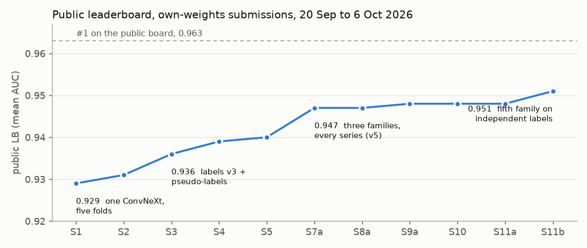
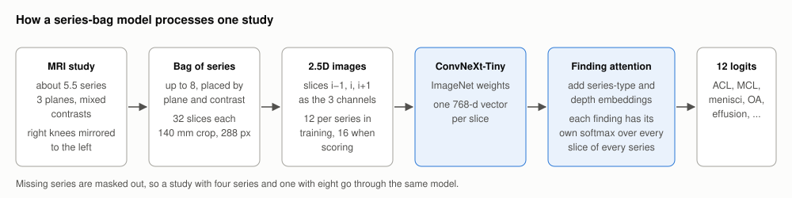
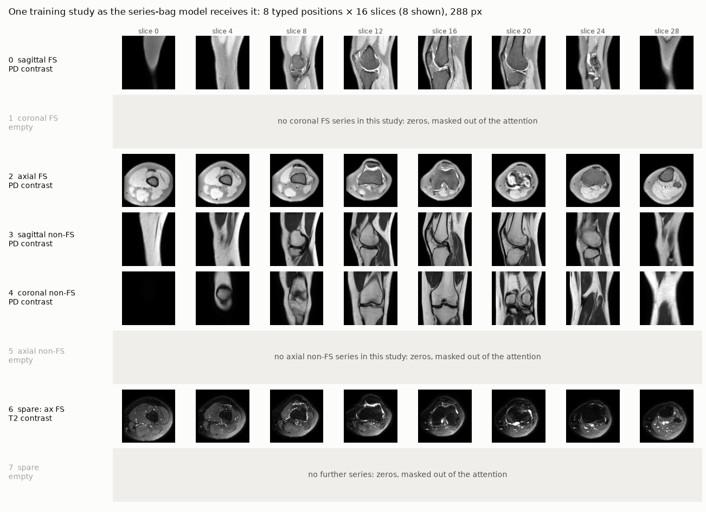
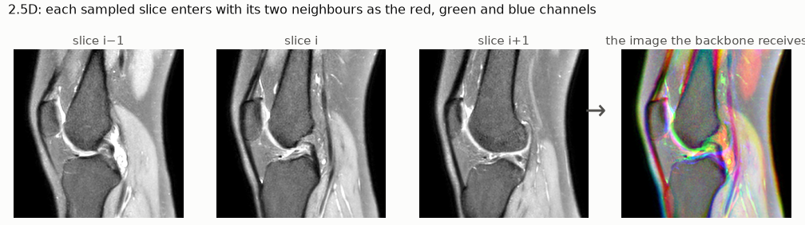
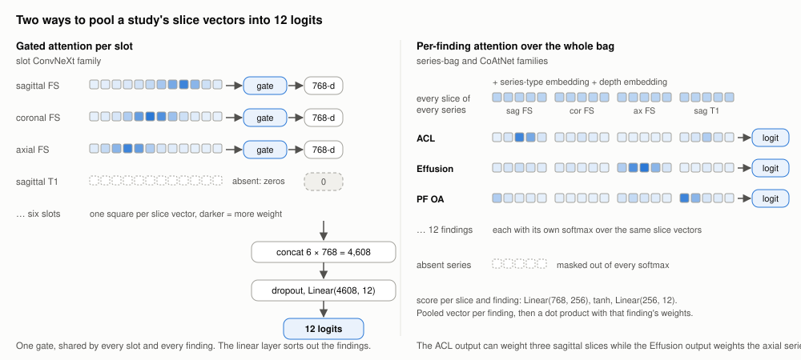
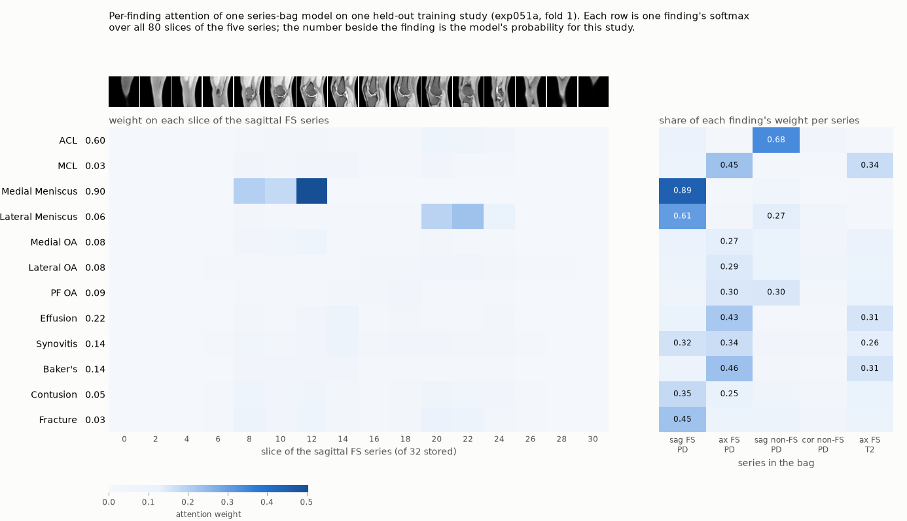
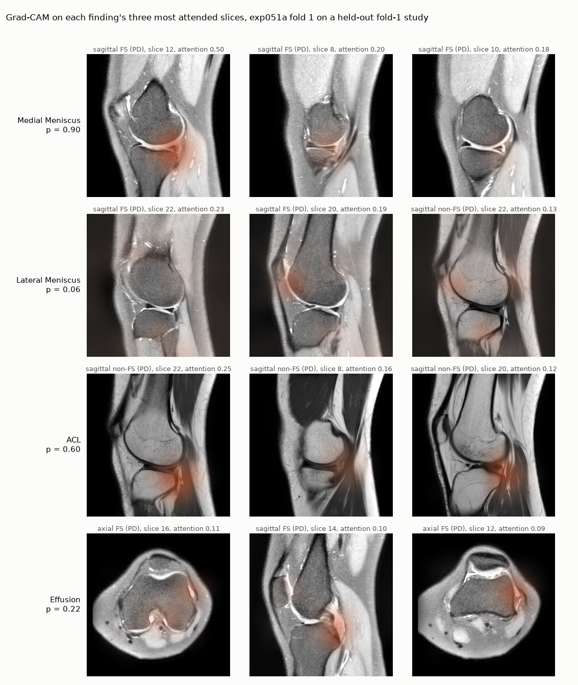
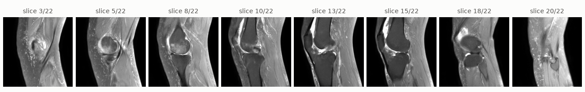

# How the solution works

Submission 11b (S11b) scores **0.951** on the public leaderboard; first place is 0.963. It is
an ensemble of 47 checkpoints from five model families, all trained by us. A second entry, built for the
efficiency prize, scores 0.948 in about four minutes.

## The problem

Each knee MRI study receives a probability for twelve findings: ACL, MCL, medial and lateral
meniscus, medial, lateral and patellofemoral (PF) osteoarthritis, effusion, synovitis, Baker's
cyst, contusion and fracture. The score is the mean of the twelve ROC AUCs, so only the ranking
of studies matters and each finding carries equal weight.

Of 4,407 training studies, 58 carry expert labels; the rest have a free-text radiology report
in one of nine languages. The hidden test set is images only, labelled by two musculoskeletal
radiologists.

## Step 1: reports to labels

A Claude model extracts a probability per finding from each report, scoring 0.90 mean AUC
against the 58 expert labels. The second prompt (v3), written after reading those 58 reports
beside their labels, removes rules the expert labels contradict, such as "avascular necrosis implies
contusion", and is stricter about mild osteoarthritis.

A pseudo-label loop then ran for three rounds. Each round's target is half the LLM label and
half the held-out ensemble prediction, quantile-mapped onto the label's distribution.

## Step 2: images to model input

One builder, run at training time and again inside the Kaggle kernel, converts each DICOM study
into a cache: slices ordered along the scan axis, a 140 mm square crop from the pixel spacing so
the field of view is constant across scanners, intensities clipped to the series' 0.5 to 99.5
percentiles, right knees mirrored to the left. Three families take six fixed slots (one series
per plane and contrast, 24 slices, 320 or 384 px); the series-bag families receive every series.

Positions 0 to 5 hold one series type each, so a missing coronal FS leaves position 1 empty and
a second axial FS occupies a spare position. The slot caches kept 85 % of the series, the bag 98 %. The
model samples 16 of the 32 stored slices per series at test time and 12 random slices in training.

## Attention and localisation

After the backbone a study is up to 128 slice vectors, with no label indicating which slice
contains the finding. The head is attention pooling (Ilse et al., 2018) in one of two forms.

The medial meniscus output assigns 89 % of its weight to the sagittal FS series, most of it to
three slices through one compartment; the lateral meniscus output weights the other end of the
stack. The ACL output weights the sagittal PD series; effusion and Baker's weight the axial
series. On the six-slot cache the per-finding head lost (EXP-020, −0.014 at one fold); it
paid only with the bag, where every slice of every series is available to it.

Attention indicates which slices a finding weights. Grad-CAM on the backbone's last stage
indicates where on those slices; the logit gradient reaches a slice through its attention
weight, so the maps below are drawn on each finding's three most attended slices.

The medial meniscus map localises to the meniscal horns, the ACL map to the intercondylar
notch, the effusion map to the joint fluid. The lateral meniscus output, at 0.06 for this
study, localises to the lateral compartment without raising its probability.
`python -m knee.eval.gradcam` produces this figure for any series-bag checkpoint and study.

## A real study

The sagittal fat-suppressed series of one training study, 8 of its 22 slices.

The report, in Spanish: *"Rotura de menisco interno. Signo de necrosis avascular subcondral en
el cóndilo femoral medial. Artrosis femorotibial medial. Derrame."* Medial meniscus tear,
subchondral avascular necrosis in the medial femoral condyle, medial osteoarthritis, effusion.
The study has no expert label.

| finding | report | LLM v2 | LLM v3 | ensemble rank |
|---|---|---|---|---|
| Medial meniscus | tear | 0.92 | 0.90 | 96th |
| Medial OA | yes | 0.88 | 0.90 | 90th |
| Effusion | yes | 0.85 | 0.75 | 89th |
| Contusion | not mentioned | 0.80 | 0.15 | 90th |
| Fracture | not mentioned | 0.55 | 0.25 | 98th |
| Lateral OA | not mentioned | 0.28 | 0.30 | 65th |
| ACL | not mentioned | 0.08 | 0.08 | 48th |

The rank is the study's percentile among the five families' out-of-fold predictions over all
4,407 training studies; no model saw its labels.

Two rows are notable. The v2 prompt mapped "avascular necrosis" to contusion; v3 removed that
rule, yet the models still rank the study 90th for contusion, partly because one family trains
on v2 labels, and 98th for fracture, which no report-based extractor does. This condylar
pattern is now commonly classified as a subchondral insufficiency fracture, so the image models
may be correct where the report is not. Without an expert label this cannot be verified.

## Step 3: training

- BCE on soft targets, each label weighted by the extractor's confidence,
  0.25 + 0.75 × 2|p − 0.5|. The 58 expert-labelled studies use hard 0/1 targets at 3× weight.
- AdamW, LR 1e-4 with the head at 10×, 14 epochs with the first 3 head-only, cosine decay,
  batch 2 with 8-step accumulation, mixed precision.
- Light augmentation: rotation ±7°, scale ±7 %, shift ±5 %, gamma and brightness jitter. No
  flips; right knees are already mirrored.
- Five folds grouped by report text and stratified by language. Each adopted recipe also has
  full-data twins trained on every study.

## Step 4: the ensemble

Predictions become ranks before averaging, since the metric depends only on ranks. Checkpoints
average within their family, then the five families get equal weight; otherwise the 23
slot-ConvNeXt checkpoints would dominate the average. A slot ConvNeXt or bag checkpoint costs about
0.25 s per study on a T4, a CoAtNet 1.0 s, hence six CoAtNet checkpoints.

The diversity came from labels, not architectures. The first three families share one label
lineage and agree at a rank correlation of 0.90. The last two train the same series-bag model on
different labels, the plain v2 LLM labels and the mean of three public LLM-extracted label sets
(correlation 0.885 and 0.873 with the round-3 family). The second added +0.003 on the public
board, the only stacking gain that transferred to the board at its offline size.

The Kaggle kernel builds all three caches from raw DICOM, runs the 47 checkpoints on two T4
GPUs in one pass, and scores the ~1,300 hidden studies in under six hours.

## The efficiency entry

E2 is two full-data series-bag twins from the round-3 family, reading bag positions 0 to 3
(sagittal, coronal and axial FS, sagittal non-FS), 16 slices each at 288 px. A threaded DICOM
loader feeds the two T4s, which crop, resize and assemble the 2.5D triples on the GPU; no cache is
written. Reading and scoring 1,300 studies takes about four minutes, for 0.948 public. The
first version scored 0.935 with the same checkpoints on a cheaper input at the wrong image
size; matching the training cache pixel for pixel was worth +0.013.

## What moved the score

| change | evidence | effect |
|---|---|---|
| Every series in a bag, three families (S5 → S7a) | public board | +0.007 |
| Fifth family on public LLM-extracted labels (S11a → S11b) | public board | +0.003 |
| Efficiency input matched to the training cache (E1 → E2) | public board | +0.013 |
| Labels v3 and the pseudo-label loop (S2 → S3) | public board | +0.005 |
| A family with no v3 labels, no loop and no expert rows (S10) | public board | 0.948, same as the loop family alone (S9a) |
| 384 px instead of 320 | five folds | level |
| ConvNeXt-Small instead of Tiny | one fold | level |
| Wider 176 mm crop | five folds | level |
| PF compartment crops at native resolution | public probe | +0.000 on PF OA |
| Longer training with EMA, heavy augmentation, no frozen stage | five folds, then public | +0.0017 offline, −0.003 public |

S10 is the decisive row. The loop gained +0.026 offline on the expert labels, yet a family
trained without it scores the same on the board; part of the offline gain came from the teacher
having seen the scored fold's labels. From then on, label-side changes were judged on the
public board.

## Where it still loses

Per-finding public AUC was measured by submitting the efficiency entry with one finding inverted;
0.5 + 6 × the score drop recovers that finding's AUC (±0.006).

| finding | public AUC |
|---|---|
| PF OA | 0.890 |
| Lateral OA | 0.896 |
| Synovitis | 0.932 |
| Lateral meniscus | 0.956 |
| other eight, mean | 0.963 |

Two findings account for most of the gap to first place. For lateral OA, every report-based
extractor tried, ours and three public ones, makes the same five false positives on the expert
set: the report states lateral disease and the radiologists graded the images negative. No
prompt can correct that. PF OA is image-limited: the extractor scores 0.96 from the text, every
image model scores about 0.89, and neither higher resolution nor compartment crops changed that.

## Code

- `src/knee/cache.py` builds the caches; `dataset.py`, `model.py`, `train.py` and `predict.py`
  cover data, models, training and inference.
- `python -m knee.eval.judge` compares two experiments pooled over five folds;
  `python -m knee.eval.gradcam` produces the maps above for one study.
- Stage 2 of `notebooks/submissions/submition-13.ipynb` is the S11b stack with the series-bag
  loader and head inline; stage 1 adds a public model and is not part of S11b.
